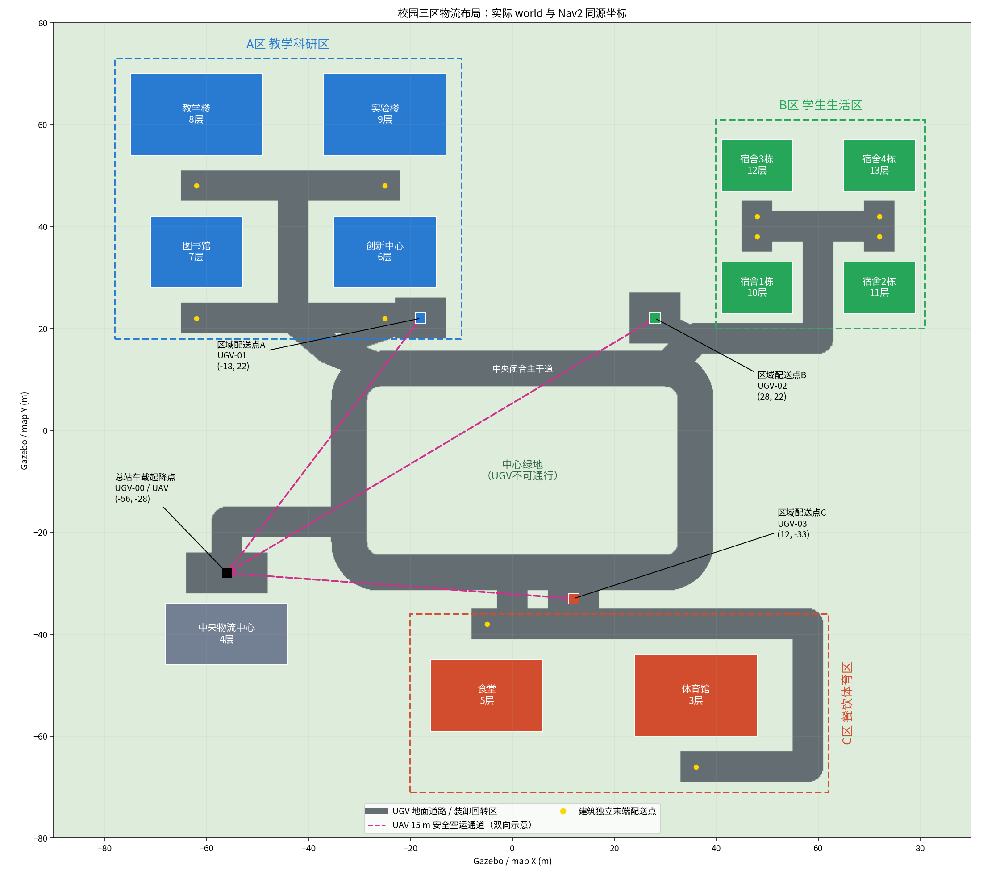

# 中央闭环、周边三区与四车配送

## 1. 最新配置

按 2026-10-19 最后补充，总站必须另有一辆承载 UAV 的 UGV，故实际为四车：
总站 UGV-00，加 A/B/C 区各一辆。主环路在中央，三个功能区在外围，不恢复公园，
实验楼与图书馆并入 A 区，食堂和体育馆同在 C 区。11 栋原建筑仅平移，不改尺寸、
高度、楼层、门窗、碰撞体；原六阶段和双车旧地图入口保留，不能同时运行。



唯一布局输入是 `simulation_ws/src/campus_regional_delivery/config/campus_regions.yaml`。
坐标系为 `map`，m/rad。地图范围 x=[-90,90]、y=[-80,80]，新静态图分辨率 0.2 m。
中央主环路控制顶点 (-32,-28)、(36,-28)、(36,12)、(-32,12)，宽 7 m，圆角半径 6 m。
主要支路宽 6 m，独立停车连接道宽 4 m。中央绿地不能让 UGV 通行，不新增湖泊。

| 站点 | 车辆 / 命名空间 | 初始 x,y | 朝向 |
|---|---|---|---|
| 总站 | UGV-00 / `/ugv_00` | -56,-28 | 北 |
| A 教学科研区 | UGV-01 / `/ugv_01` | -18,22 | 北 |
| B 学生生活区 | UGV-02 / `/ugv_02` | 28,22 | 北 |
| C 餐饮体育区 | UGV-03 / `/ugv_03` | 12,-33 | 北 |

UGV 生成 z=0.005 m，实际地面接触后底座约 z=0.001 m。UAV 初始 z=0.425 m，
表示已装载在总站车上：模型插入时由原严格物理捕获插件检查实际距离和速度后
建立固定连接，避免等待订单时因接触振动滑移。捕获失败仍报告失败，不扩大
捕获范围。任务开始前复核新鲜定位和锁定几何；后续着陆仍由 PX4 控制下降、
触地解除武装，再通过停稳窗口捕获，不用远距离模型重叠假装成功。
平台沿用原固定几何，着陆目标 z=0.42 m，禁止移动车辆着陆。
A 点由旧草稿 (-28,22) 移至 (-18,22)，避免停在建筑支路中间；B/C 也不在主行车道中央。
区域模拟货物交接位置 A=(-18,19,0.6)、B=(28,19,0.6)、C=(15,-33,0.6)。

每车独立 RSP、odom、TF 前缀、Nav2 Action、局部/全局代价地图和碰撞监控，共享
静态 `/map`。车辆间占用层各自只标注其他三车，绝不标注自己。定位沿用 Gazebo
真值，不声称完成 SLAM 或 GPS/IMU 融合。初始位置不同不靠多套 Gazebo 实现。

| 区域 | 楼栋目标 | 建筑中心 | 门前配送点 | 朝向 | 原楼层数 |
|---|---|---|---|---|---:|
| A | `teaching_building` | -62,62 | -62,48 | 北 | 8 |
| A | `library` | -62,35 | -62,22 | 北 | 7 |
| A | `laboratory` | -25,62 | -25,48 | 北 | 9 |
| A | `innovation_center` | -25,35 | -25,22 | 北 | 6 |
| B | `dormitory_1` | 48,28 | 48,38 | 南 | 10 |
| B | `dormitory_2` | 72,28 | 72,38 | 南 | 11 |
| B | `dormitory_3` | 48,52 | 48,42 | 北 | 12 |
| B | `dormitory_4` | 72,52 | 72,42 | 北 | 13 |
| C | `cafeteria` | -5,-52 | -5,-38 | 南 | 5 |
| C | `gymnasium` | 36,-52 | 36,-66 | 北 | 3 |

## 2. 两种启动模式

首次安装官方中间件：`sudo apt install ros-humble-rmw-cyclonedds-cpp`。
新入口默认选择 Cyclone DDS；所有任务/状态终端也必须使用相同实现。旧入口不强制
改变 RMW。此前 Fast DDS 下出现过晚加入节点丢失地图/TF/服务的现象，不能只凭此
断定唯一根因。Cyclone 下实际完成四车规划与短程运动，见第 5 节。

终端一，编译并启动协同模式（四车 + 一个 PX4 UAV）：

```bash
cd ~/design_final/wqi_final/simulation_ws
bash ./build_workspace.sh --executor sequential
source ./setup_workspace.bash
export RMW_IMPLEMENTATION=rmw_cyclonedds_cpp
ros2 launch campus_regional_delivery regional_campus.launch.py gui:=true rviz:=true
```

或者，在关闭上一套仿真后启动纯 UGV 对照：

```bash
cd ~/design_final/wqi_final/simulation_ws
source ./setup_workspace.bash
export RMW_IMPLEMENTATION=rmw_cyclonedds_cpp
ros2 launch campus_regional_delivery regional_campus.launch.py \
  delivery_mode:=ugv_only gui:=true rviz:=true
```

纯 UGV 模式不生成 UAV、不启动 PX4；总站 UGV-00 访问楼栋后返库，区域三车不动。
两种模式使用相同 world、建筑目标、地面速度/导航参数和默认卸货等待时间。
启动先生成四车，再生成 UAV/PX4 模型，模型成功插入后才依次激活四车导航，
每车等待全部八个节点就绪，最后打开 RViz，因此 RViz 比 Gazebo 晚出现。
UAV 插入看门狗与每车导航阶段各有 240 墙钟秒上限，不通过就停止，不关闭心跳绕过。
软件渲染默认 `LP_NUM_THREADS=2`，只限制 Mesa 渲染工作线程，不关闭窗口或传感器；
可在启动前设置该环境变量覆盖。禁止同时运行另一套 Gazebo/PX4。
本机一次 RViz 退出转储的调用栈位于 Mesa swrast/LLVM/OGRE 渲染路径，尚未定位
最初的堆内存损坏来源。新四车入口增加 `rviz_render_driver:=softpipe`（默认），
仅给 RViz 设置 `GALLIUM_DRIVER=softpipe`、`DRAW_USE_LLVM=0`；Gazebo 不受该局部
环境影响，仍保留原配置。`rviz_render_driver:=llvmpipe` 可恢复原路径。
本机 softpipe RViz 启动/正常关闭冒烟测试通过；完整场景结果另记，不能仅据此宣称
所有图形问题已解决。softpipe 可能更慢，首次地图 GLSL 警告仍存在。
渲染开关依据 [Mesa 环境变量说明](https://docs.mesa3d.org/envvars.html) 与
[驱动说明](https://docs.mesa3d.org/systems.html)，本地二进制确认支持这两个环境变量。
默认每车用 `regional_nav_container` 包装轻量 C++ `regional_component_container`，
其中仍加载官方 Nav2 组件，不替换规划器或控制器算法；`use_composition:=false`
是独立进程诊断选项。此前 Fast DDS 的组件/UDP
对照未通过启动验收；改用 Cyclone DDS 后已完成组件化四车启动与总站起降专项。
该轮 `component_container_isolated` 的退出等待仍异常，检查本机 Humble 头文件发现
它在析构时等待 executor 的 is_spinning 状态；最终换成多线程共享执行器，避免
依赖该等待路径。完整 A 区配送和退出分别记录，不将一次专项扩大为全通过。
早期 0.1 m 四车大图运行时内存/交换接近耗尽，实际导航超时；仅对搜索降采样未能
完成该轮启动验收。最终新地图以 0.2 m 栅格导出为 900×800，实际尺度、建筑、道路和
目标坐标不变。静态层据新地图调整全局网格，局部代价地图仍为原 0.05 m；不再额外
对 Smac 搜索降采样，控制器、安全检查、速度和传感器保持原配置。
这是一项新场景地图分辨率调整，并非与旧地图完全相同；两种新模式使用同一新地图。
`uav:=false` 是仅查看四车的额外开关，不等于指定纯 UGV 任务模式。
`gui:=false`、`rviz:=false` 分别关闭窗口；`visualize_sensor_rays:=true` 只开启
Gazebo 射线示意，默认不显示示意但传感器仍工作。不要同时启动旧校园导航或任务节点。

终端二，两模式都可发送相同的地面服务订单：

```bash
cd ~/design_final/wqi_final/simulation_ws
source ./setup_workspace.bash
export RMW_IMPLEMENTATION=rmw_cyclonedds_cpp
ros2 action send_goal /regional_delivery/execute_mission \
  cooperative_delivery_interfaces/action/ExecuteCooperativeDelivery \
  "{targets: ['innovation_center'], payload_masses_kg: [0.30], return_home: true}" --feedback
```

多区域示例：

```bash
ros2 action send_goal /regional_delivery/execute_mission \
  cooperative_delivery_interfaces/action/ExecuteCooperativeDelivery \
  "{targets: ['teaching_building','dormitory_1','cafeteria'], payload_masses_kg: [0.30,0.25,0.20], return_home: true}" --feedback
```

目标和载荷数组一一对应；协同模式按区域分组、每批最多 1 kg UAV 载荷。纯 UGV 不
应用 UAV 的 1 kg 限制，但没有新增实物载荷碰撞体或真实质量标定。当前两模式都按
区域及输入顺序服务，不宣称全局最优任务顺序；实际道路段由 Nav2 规划。

仅协同模式支持 `target_floors: [3]` 这样的楼层数组。纯 UGV 收到楼层请求会拒绝，
因为地面车不能送到上层；不能用门前交货与三楼交货直接对比为同等任务。
`return_home: true` 是推荐完整闭环。协同 `false` 留在最后区域车，下一单目前需要
回到总站车，尚未实现从任意停靠点恢复的连续调度。

终端三，查看状态，以下命令一次运行一条：

```bash
cd ~/design_final/wqi_final/simulation_ws
source ./setup_workspace.bash
export RMW_IMPLEMENTATION=rmw_cyclonedds_cpp
ros2 topic echo /regional_delivery/readiness
# Ctrl+C 后换另一条
ros2 topic echo /regional_delivery/mission_status
ros2 topic echo /regional_delivery/landing_status --qos-durability transient_local
ros2 topic echo /regional_delivery/capture_status --qos-durability transient_local
ros2 topic echo /regional_delivery/cargo_events
ros2 topic echo /uav/docked_carrier
```

降落分为 `UAV_APPROACH`（下降到配置的 0.8 m 接近高度）和 `UAV_LANDING`
（PX4 对准、触地、解除武装及车顶捕获）。降落期间每仿真秒发布实测高度与剩余
高度差，任务终端 `--feedback` 同步更新剩余距离；主终端日志至少间隔五墙钟秒，
实际频率还受仿真时钟速度限制。
`landing_status` 的 `DOCKED_VERIFIED` 需要实际停靠车辆匹配、PX4 落地解除武装、
定位新鲜，以及连续 0.5 仿真秒内高度误差 <=0.05 m、水平误差 <=0.12 m。
返航恢复导航后还会再次复核，不能只靠一个缓存的落地状态宣布 COMPLETED。
Iris 中心约 0.42 m，接触平台顶面约 0.365 m，二者的 0.055 m 差值是碰撞体厚度。
原始飞控、碰撞形状和控制参数不因此调低；实际装卸依然是模拟事件。

`capture_status` 仅用于捕获阶段诊断，报告 `expected_carrier`、`distance_m`、
`filtered_speeds`（车辆线/角速度、无人机线/角速度，依次为 m/s、rad/s、m/s、rad/s）
和 `reason`。位置超限为 `OUTSIDE_CAPTURE_DISTANCE`，持续运动为 `VELOCITY_LIMIT`，
定位缺失/陈旧为 `STALE_OR_MISSING_ODOMETRY`，门限内等待稳定窗口为 `SETTLING`。
稳定窗口按新里程计时间推进，重复旧样本不能充当连续停稳。超时携带最后观测，
不会继续显示准备阶段遗留的 `waiting for READY`。

READY 在提交任务并完成实际就绪检查后发布。等待时发布 JSON，包含具体等待项、
缺失里程计、UAV 状态和 PX4/飞行 Action 就绪情况；超时结果也带等待项。
UAV 状态订阅使用 Transient Local，能接收管理器启动前已发布的已降落状态，
不要求飞控重复改变状态。纯 UGV 不等待 PX4 或 UAV 状态。

仿真启动只进入 IDLE，不自动提交订单。新地图使用 `/regional_delivery/execute_mission`，
旧 `/cooperative_delivery/execute_mission` 与单机 `/uav/execute_delivery` 不是本入口。
启动日志会显示正确接口、模式、ROS_DOMAIN_ID 和中间件；任务准入结果保留在
`/regional_delivery/task_admission`，包括 accepted、reason、targets、valid_targets。
例如 `dormitory` 会因不能明确四栋中的哪一栋而拒绝，单件超过 1 kg 会报告具体载荷上限。
两终端均 source 工作空间并使用同一 RMW/域，再执行以下命令：

```bash
ros2 action info /regional_delivery/execute_mission
ros2 topic echo /regional_delivery/task_admission --qos-durability transient_local --once
```

`action info` 应有一个 server。`task_admission` 用于查看最近一次尝试；尚未发送
任何任务时没有准入事件。Ctrl+C 后的 Deactivating/Cleaning up/Destroying bond
是正常关闭，不是配送失败的错误原因。

### 单车独立导航检查

仅在没有协同任务运行、四套导航已经激活时使用。每条命令等待结束后再执行下一条，
不要用手动目标抢占协同管理器的目标。仍需先 source 工作空间并统一 RMW。

```bash
# A 车：创新中心门前
ros2 action send_goal /ugv_01/navigate_to_pose nav2_msgs/action/NavigateToPose \
  "{pose: {header: {frame_id: map}, pose: {position: {x: -25.0, y: 22.0}, orientation: {z: 0.70710678, w: 0.70710678}}}}" --feedback
# A 车：回配送点
ros2 action send_goal /ugv_01/navigate_to_pose nav2_msgs/action/NavigateToPose \
  "{pose: {header: {frame_id: map}, pose: {position: {x: -18.0, y: 22.0}, orientation: {z: 0.70710678, w: 0.70710678}}}}" --feedback
# B 车：宿舍 1 门前
ros2 action send_goal /ugv_02/navigate_to_pose nav2_msgs/action/NavigateToPose \
  "{pose: {header: {frame_id: map}, pose: {position: {x: 48.0, y: 38.0}, orientation: {z: -0.70710678, w: 0.70710678}}}}" --feedback
# C 车：食堂门前
ros2 action send_goal /ugv_03/navigate_to_pose nav2_msgs/action/NavigateToPose \
  "{pose: {header: {frame_id: map}, pose: {position: {x: -5.0, y: -38.0}, orientation: {z: -0.70710678, w: 0.70710678}}}}" --feedback
```

B/C 返回目标见第 1 节配送点坐标，朝向北使用 z=w=0.70710678。总站车接口为
`/ugv_00/navigate_to_pose`。以上是可执行验收步骤，不代表这些全部物理长路线已经通过。

## 3. 协同流程与限制

总站车平台捕获确认 -> UAV 起飞解锁 -> 15 m 区域空运 -> 区域车静止等待 ->
UAV 进近/着陆/解除武装 -> 连续稳定检查 -> 物理锁定 -> 模拟交货 -> 区域 UGV
末端配送 -> 返回本区配送点 -> UAV 返回并降落锁定总站车。

任务状态区分 `PREPARING`、`UGV_PARKING`、`UAV_TAKEOFF`、`UAV_HOVER`、
`UAV_TRANSPORT`、`UAV_LANDING`、`CARGO_HANDOVER`、`UGV_LAST_MILE`、
`GROUND_DELIVERY`/`UAV_FLOOR_DELIVERY`、`UGV_RETURN_DEPOT`、`UGV_RETURN_HUB`、
`COMPLETED`、`FAILED`、`CANCELED`。

- 车顶目标取接收车实时静止位姿，而不是 Nav2 名义停车坐标。
- 飞控保持 PX4 SITL + ROS 2 Offboard，不持续修改实体坐标模拟飞行。
- UAV 空运/楼层飞行前暂停静止车辆的 Nav2 生命周期；地面移动前恢复对应车辆，
  正常任务结束恢复全部车辆。暂停包含地面代价地图与地面 collision_monitor，
  所以 RViz 地面代价地图在这段时间保留最后数据；原始传感器、RSP、定位与 UAV
  飞控/安全监控仍运行。此时全部地面车必须停车，不是动态环境中行驶的避障策略。
  暂停/恢复的单元用例通过，原生起降专项结果需另外验收。
- 停车/捕获管理器复用 0.25 s 时间常数滤波和连续一秒稳定窗，避免接触尖峰反复
  打断准入；物理插件最终仍检查原始速率与原距离门限，不允许移动车辆强制锁定。
- 装卸是明确标注 simulated 的任务/载荷事件，不是实体机械抓取或真实包裹转运。
- 楼层高度沿用 1.6+3.2×(层数-1) m；新布局的全楼层整程仍待验收。
- 本入口暂不接入四车九电池（四驱动、四充电源、一个 UAV）整程约束；旧双车五电池
  功能保留在旧入口。没有完成新布局能耗统计、全局最优调度或正式对照实验矩阵。
- 失败时取消活动导航/飞行并停车，空中自动回收与重启恢复尚未完整验证，不能
  无人值守连续批量运行。

## 4. 文件与资产

新增 `simulation_ws/src/campus_regional_delivery/`：

| 文件 | 作用 |
|---|---|
| `config/campus_regions.yaml` | 总站、三区、四车、航路、道路和全部配送点 |
| `assets/campus_regional.world` | 新三维世界，原建筑几何保留 |
| `assets/regional_map.pgm/.yaml` | 新二维地图，900×800，0.2 m |
| `assets/regional_keepout.pgm/.yaml` | 道路禁行/柔性边缘掩膜 |
| `assets/building_geometry.yaml` | 原模型几何及楼层导出 |
| `assets/delivery_waypoints.yaml` | 14 个有效站点导出 |
| `assets/uav_targets.yaml` | 总站到三个区域的 15 m 安全航线 |
| `assets/layout_validation.json` | 源哈希、道路连通和净距证据 |
| `assets/campus_layout_preview.png` | 与实际世界一致的俯视图 |
| `campus_regional_delivery/layout.py` | 布局/可达性/订单分组校验 |
| `campus_regional_delivery/assets.py` | 从同一配置生成上述资源 |
| `campus_regional_delivery/fleet.py` | 复用成熟模型及参数生成四车命名空间配置 |
| `campus_regional_delivery/localizer.py` | 独立车辆真值 TF |
| `campus_regional_delivery/markers.py` | 地图目标与四车站点标注 |
| `campus_regional_delivery/mission_manager.py` | 协同与纯 UGV 对照任务入口 |
| `campus_regional_delivery/startup.py` | 有界的八节点生命周期就绪检查 |
| `campus_regional_delivery/container_guard.py` | 保持 ROS 上下文直到生命周期关闭和组件卸载结束 |
| `src/regional_component_container.cpp` | 官方组件加载及最终状态校验、上下文清理适配 |
| `launch/regional_campus.launch.py` | 一套 Gazebo、四套 Nav2、可选 PX4 |
| `test/test_regional_*.py` | 布局、车辆、任务、安装入口及启动就绪用例 |
| `test/test_container_guard.py` | 最终状态、重复关闭及失败可见性 |
| `test/test_component_lifetime.py` | 行为、Smac、RPP、平滑器真实 ROS 析构/退出回归 |

另有标准包清单、CMake、五个 Python 入口和一个 C++ 容器入口；其中 `wait_for_regional_navigation` 必须有
源码可执行位，启动前和安装回归都检查它。原实现的对接部分仅给
`cooperative_delivery/src/ugv_uav_docking_plugin.cpp` 增加可选白名单/初始吸附开关，
不改原双车默认行为。旧 world、地图、原 Nav2 和 UAV 配置不覆盖。
另将共享车辆占用层 `cooperative_delivery/src/peer_vehicle_layer.cpp` 的更新循环
限制在车辆圆形包围框与 dirty window 的交集，避免四车大图全区重复遍历；半径、
代价、陈旧数据 fail-closed 和旧位置清理不变，并通过新增逐格参考对照测试。
临时车模、构建、日志与试验便利脚本仍在仓库外。普通拉取只需编译，不必重新生成地图。

以后主动更改中央配置时，重新生成并编译：

```bash
cd ~/design_final/wqi_final/simulation_ws
source ./setup_workspace.bash
MPLCONFIGDIR=/tmp/regional_mpl /usr/bin/python3 -m campus_regional_delivery.assets \
  --layout src/campus_regional_delivery/config/campus_regions.yaml \
  --source-world src/ugvcar_description/world/campus_delivery.world \
  --source-layout src/ugvcar_description/config/campus_layout.yaml \
  --output src/campus_regional_delivery/assets
bash ./build_workspace.sh --executor sequential
source ./setup_workspace.bash
```

启动校验布局哈希，拒绝静默混用过期地图。
新增标识牌的 visual/collision 名称已区分，尺寸和碰撞几何没有改变；SDF 校验通过。

## 5. 验收边界

四车版本 16 包编译通过。最终测试汇总及原生退出结果在本节末尾记录。
新测试覆盖布局、四车隔离、任务准入、退出事件、生命周期及插件析构。
汇总包含 CTest 包装项，
不等于唯一单元用例数。
按车辆半径腐蚀后，14 站点处于同一道路连通域，铺装与建筑物不重合。
所有区域停车中心与非停车支路之间保留车辆净空，新增专项测试通过。

`four_vehicle_cyclone_01` 使用 Cyclone DDS，全部四车导航就绪，完成 40 条真实
`ComputePathToPose`（区域车到本区楼栋和总站车到所有楼栋，均含返回）及 8 段
真实短程 `NavigateToPose`。总站首次物理锁定、承载 UAV 行驶通过。起飞后出现
`Simulation velocity fusion lost; requesting PX4 native landing`，PX4 随后报告
着陆/解除武装；该轮未通过悬停、回收或整程验收。操作者结束回归，最终 JSON 保留
中断标记与原始日志，不计为配送完成；退出无段错误/强制终止记录。
`four_vehicle_parked_navigation_sortie_01` 四车导航就绪，但总站首次捕获等待超时，
未起飞，四套导航均完成有序关闭。这不是对暂停飞行策略的成功验证。

`four_vehicle_cyclone_composed_01` 在系统正式 Cyclone DDS 下四车组件化启动通过。
首次捕获前暂停静止导航；总站车承载 UAV 完成短程往返，端点误差 0.3120/0.1320 m。
四车暂停、真实 PX4 起飞、5 秒仿真悬停、车顶降落/解除武装/重新物理捕获、四车恢复
均通过。悬停最大 XY 漂移 0.02746 m，高度变化 0.12911 m；四车可选择，远距离捕获
被拒绝。该轮没有重新执行 40 条规划，也不是区域配送验收。功能 passed=true 与
退出异常分开记录：四个 isolated 容器最终被强制清理，退出约 31.79 s。不能把它
称为干净退出。最终多线程容器与首次捕获顺序已加入源码和回归测试。
该轮启动采样 RAM 约 6.5 GiB，先前独立进程约 8.2 GiB；不是严格同时间性能统计。

`four_vehicle_mt_mission_01/02` 在准备阶段被主动结束，未起飞、未完成目标。第二轮
新增诊断明确显示：里程计、PX4 与飞行 Action 均就绪，但管理器 UAV 状态为 null。
原因是管理器晚于首次状态发布启动，却用 Volatile 订阅；现已改为 Transient Local，
真实 DDS 的“先发布一次、再创建管理器”用例通过。长时间未锁定使 UAV 从平台滑落，
因此不以放宽距离门限继续该轮。两轮旧多线程容器退出仍有段错误，原始日志保留。
`four_vehicle_guarded_mission_01` 实际完成 0.30 kg 名义载荷的创新中心门前订单，
Action 成功且 completed_targets=1。物理停靠归属依次为总站车、A 车、总站车；
交接时 UAV 已降落锁定 A 车，区域车配送后回库，最终 UAV 降落解除武装并锁定总站车。
独立核查门前采样误差 0.079456 m，最终车顶相对位置误差 0.0000621 m，采样飞行
期间最大地面车位移 0.001701 m。极小对接误差来自仿真锁定约束，不是实物精度；
采样位置不是连续碰撞认证。墙钟 1076.6 s 含启动与退出，不能当成配送效率。
该轮四个保护器均退出失败，整体独立验收 passed=false，不能把 Action 成功当成
全系统正常退出。原记录器遗漏非段错误退出，现已补充严格检测，不修改原始日志。

退出适配先读取全部生命周期状态，已 FINALIZED 时不重复 SHUTDOWN，再验证八个
节点最终状态，允许通过官方服务逆序卸载。上下文保持到组件销毁结束，等待有界，
失败显式返回。五项保护器用例覆盖重复关闭、活动节点拒绝和失败可见性。
`four_vehicle_mixed_shutdown_01` 验证活动节点卸载被拒绝，此后总站车短程往返
成功（端点误差 0.3130/0.1296 m）；四套退出均卸载前五个组件后卡在 behavior_server，
保留为退出失败记录。新清理顺序回归另列，不通过强制杀死来假装正常退出。

后续父进程 GDB 单组件复现证实：行为插件库卸载后，生命周期对象仍有插件中的
弱引用控制块；规划器内的代价地图回调组也有同类析构问题。仅延长行为库生命周期
使卸载推进到规划器，但还不够。一次性预加载全部插件干扰工厂注册，已撤回该方案，
失败回归 `four_vehicle_plugin_lifetime_01/02` 保留。
最终适配只在组件卸载前对**已经加载**的插件库设置 Linux `RTLD_NODELETE`，
配合 `RTLD_NOLOAD`，不预加载、不实例化插件，并平衡动态库句柄计数。代码映射
保留到进程结束，使剩余弱引用能先安全析构；不修改系统 ROS 安装或插件算法。
该兼容层针对当前 Ubuntu/glibc，迁移到其他系统应重新验证。
行为、Smac、RPP、平滑器四类实际组件的加载/配置/关闭/卸载及正常退出专项
均通过，并检查子代价地图无配置错误；这仍不替代整程 Gazebo 验收。

**最终回归 `four_vehicle_loaded_mapping_01`：**Gazebo 与 RViz 均开启，纯 UGV
模式四车全部就绪，活动组件卸载请求被正确拒绝，此后总站车实际短程往返成功，
端点误差 0.31469/0.11570 m。关闭时总站栈已 FINALIZED，其余三栈仍 ACTIVE，
保护器分别处理两种状态；每套均逆序卸载全部 9 个组件，四个错误数组均为空。
总退出 7.94746 s，没有进程错误、段错误、强制终止或重复 launch shutdown。
该轮没有 UAV/PX4，不代替最新容器下的完整空运/楼层回归。
RViz 仍出现一次 VM 软件渲染的 indexed-image GLSL 警告；窗口与地图数据加载已
记录，但当前四车加 UAV 的完整像素显示仍需用户确认，不能引用旧三模型确认。

2026-10-19 全工作空间基线为 16 包构建通过（26.4 s）；测试汇总 **666 项、0 错误、0 失败、
23 跳过**。新包 67 个 pytest 用例及 5 个 CTest 包装项通过，其中四项为真实 ROS
组件析构/退出测试；车辆占用层 5 个 C++ 用例通过。23 项跳过均由现有 ament
检查器对 cppcheck 2.7 性能问题的策略产生，未删除测试或新增跳过绕过失败。
旧 world、地图、UGV/UAV 原配置与修改前压缩快照逐项比较一致，SDF 校验通过。

### 2026-10-20 降落与完整回归

新降落反馈和实测复核已编译，88 个新包测试用例及 5 个 CTest 包装项通过。
没有把总目录中混合其他包旧记录的 687 项汇总冒充本轮全部重测。
车顶起降专项 `deck_landing_02` 功能通过、整体失败（RViz 退出 -11），原记录保留。
其 Gazebo 最终 z=0.420971 m，TF z=0.420968 m，额外 5 仿真秒保持停靠。

使用最终代码和 RViz 默认 softpipe 后，`delivery_landing_03` 完整回归通过：
正式 Action 接受 innovation_center、0.30 kg、返航，不指定楼层；总站车起飞、
A 车降落/物理锁定、模拟交接、A 车门前投递并返回、UAV 返回总站车顶。
Action status=SUCCEEDED、success=true、完成目标 1；2026-10-20 23:12:31 完成。
Gazebo 原生中心 z=0.420999 m，TF z=0.420999464 m，额外等待 5 仿真秒所得
16 个样本均 LANDED 且锁定 ugv_00，没有再次升起。关节约束后的微小偏差不作为
自主降落精度标定。四套导航各卸载 9 个组件、错误数组为空，RViz 本轮正常退出，
无非预期进程退出；正常 SIGINT 后 DDS Agent -2 单独识别。清理耗时 5.956 s。

本轮从启动至清理总墙钟 1178.676 s，包含初始化、额外观察及退出，不当作正式
配送效率数据。首次地图 GLSL 警告仍存在，未做桌面像素截图验收，也不宣称解决
所有机器的图形故障。运行时源码、原失败/中断、原始日志和最终降落高度图在仓库外
`/home/wqi/design_final_artifacts/regional_upgrade/20261020/`。

### 2026-10-21 食堂二楼与初始装载

用户 23:24 场景的食堂订单在总站初始捕获窗口超时，尚未起飞，不是二楼航线失败。
旧配置等待订单期间未锁定，复现可观测到接触滑移；原日志没有记录最后捕获位置，
不能虚构超限数值。新配置初始严格机械捕获并在任务开始前复核，不放宽后续门限。

`cafeteria_floor2_05` 等待 300 墙钟秒再发单，已成功完成食堂二楼、0.30 kg、返航的
正式 Action 闭环：C 车接收、门前停车、4.8 m 悬停模拟投递、落回 C 车、车返站和
UAV 停回总站车。最终额外 5 仿真秒、37 个样本均 LANDED 且锁定 ugv_00；Gazebo
中心 z=0.420998 m 与 TF 一致。固定关节样本不作为自由飞行精度标定。

**配送功能通过，整轮退出未通过：**RViz 关闭时报显存/堆错误，退出 -6；一个定位
节点也在 DDS 回调退出竞态中退出 1。保留 `functional_passed=true, passed=false`，
独立判据完整列出两项异常。四套导航虽各卸载 9 个组件且错误数组为空，不等于所有
进程均正常。softpipe 并未消除所有图形故障，仍需要针对 RViz 处理。
定位节点随后调整为先停执行器、再销毁 ROS 上下文；持续接收真实 ROS 消息时
SIGINT/SIGTERM 专项均退出 0。最终 98 个包内用例和 5 个 CTest 包装项通过；未在
该定位退出修改后再次重跑整程 GUI，也未宣称 RViz 退出已修复。

### 2026-10-23 食堂返站转角修复

后续用户运行的失败发生于 C 车返站，不是 UAV 未完成二楼起降。空载车实际 Nav2
往返也复现了返程 status=6，规划线在 (7,-35) 附近的最小采样净空约 0.576 m，
小于局部 0.60 m 安全包络，RPP 因此正确停车并最终中止。

新场景的 `fleet_parameters` 现在根据实际地图分辨率给全局规划增加粗栅格量化与
跟踪余量。本图全局规划半径 1.00 m、膨胀范围 1.40 m；局部碰撞包络仍 0.60 m。
这不是扩大实体车，也不影响旧图、原 Nav2 YAML、控制器、速度、PX4 控制参数和对接门限。
没有通过删除碰撞保护或缩小局部安全区来消除报错。全部配送点在保守全局净空下
仍连通；107 个用例和 5 个 CTest 包装项通过。Gazebo/RViz 同开，空载 C 车连续
两轮食堂往返 4 段导航全部成功，最大端点误差 0.225 m，碰撞预测警告 0，四套
导航和两个 GUI 正常清理。此专项不等于载机闭环通过，完整运行证据见实验报告
同日小节。首次完整回归又因 ROS 速度融合健康检查误报而在悬停后中止；ULog
显示 PX4 融合本身有效。随后修复可复现的多线程时间快照竞态并增加诊断，原失联
保护门限不变。两个受影响包合计 251 个用例通过；不能据此宣称完整闭环已通过。

随后 `cafeteria_floor2_03` 实际完成正式食堂二楼、0.30 kg 闭环，Action 为
SUCCEEDED，完成目标 1，UGV-03 载机返站成功。整程碰撞预测和融合丢失警告均为 0；
载机转角 71 个位置样本最小铺装净空约 1.158 m（不是连续轨迹保证）。
Gazebo 最终中心高度 0.420964 m，TF 一致；额外 5 仿真秒的 25 个样本均已落车并
锁定总站车。四套导航正常清理，但 RViz 关闭时仍退出 -6，因此只认配送功能通过，
整轮仍 `passed=false`。图形故障没有根治，原始判据和降落曲线在仓库外保留。

### 后续验收顺序

1. 解决 RViz 退出异常；C 区食堂二楼功能已在本轮重新通过，继续重复 A/C 案例并完成 B 区平台着陆和返航。
2. 分别完成三辆区域车的全楼栋往返，以及总站纯 UGV 相同订单 Action 对照。
3. 检查楼层、多区域、多订单、取消和异常回收，并连续重复任务。
4. 接入四驱动电池、四充电源和 UAV 电池，重新建立新布局能耗证据。
5. 重新验证新图动态障碍场景，再采集效率、能耗和成功率统计。

不把正在运行或尚未执行的项目写成通过。纯 UGV Action 全路线、全楼栋物理往返、B 区及 C 区其余任务、楼层/多订单重复、
新图动态实验、九电池和量化能源对照尚不能宣称验收完成。

历史三车记录仅作开发证据：20 条规划、6 段短程运动和总站地面起降通过；首个 A 区
整程在车顶着陆后因原始角速度停车窗口超时，完成目标 0。后续三车测试因用户新增
总站车要求主动取消，不能计为新四车失败率或成功率。部分原生 GUI/DDS/Gazebo
退出异常与 VM 调度警告仍需监控，不将一次正常退出扩大为根因已消失。

证据在仓库外 `design_final_artifacts/regional_upgrade/20261019/`，旧失败、中断和新
回归分别保存。代码能力、路径规划通过和实际整程成功必须分别表述。
