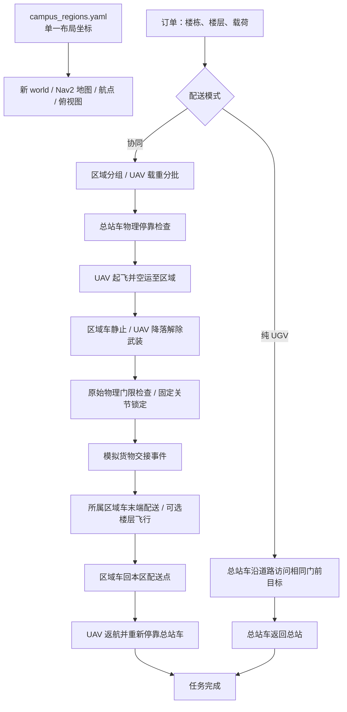
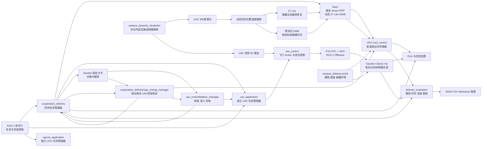
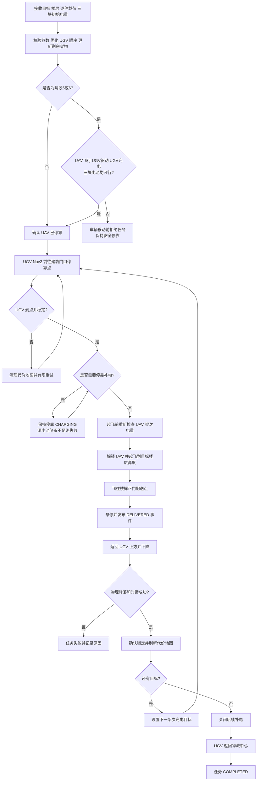
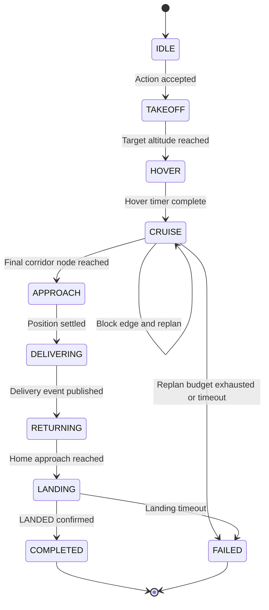
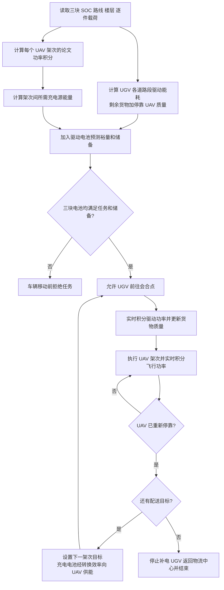
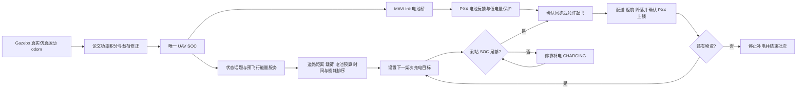
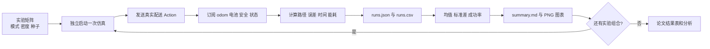

# 校园 UGV-UAV 协同配送系统架构

## 系统边界

## 当前四车分区场景

2026-10-19 新入口为 `campus_regional_delivery/regional_campus.launch.py`。
一套 Gazebo 中配置总站 UGV-00 与 A/B/C 区的 UGV-01/02/03，共享静态地图，
各自维护 TF、Nav2、目标和局部代价地图。中央环路、世界、导航图与任务坐标
来自同一配置。旧单双车入口保留，不能与新入口同时启动。

地面规划复用原静态 SmacPlanner2D + Regulated Pure Pursuit；UAV 仍为 PX4 SITL
+ ROS 2 Offboard。接收车必须停车，飞行期间暂停静止车辆的地面 Nav2，恢复后才
允许地面导航。真实锁定和承载、40 条规划、8 段短程运动已实测；另有一次 A 区
创新中心空运/交接/地面配送/返航闭环成功，但该轮导航容器退出仍失败。B/C 整程
与重复验证尚未完成，不能把下方旧单双车能耗与重复实验直接算作四车完成项。
后续只修改退出适配的四车地面专项完成全部组件卸载，7.95 s 正常退出；不冒充
最终代码下重新通过了完整空运任务。
四驱动电池、四充电源和 UAV 电池的九电池约束尚未接入新入口。
坐标、命令和失败记录见 [三区四车说明](regional_campus.md)。

## 兼容入口边界

本项目的最终交付范围是 Ubuntu 22.04、ROS 2 Humble、Gazebo Classic 和
RViz 上的电脑端物理仿真。系统不依赖开发板、真实电池或真实电流传感器；UAV
仅使用 PX4 SITL 软件在环飞控和 ROS 2 Offboard 接口。

新增的双车接力入口为 `relay_delivery.launch.py`，由独立管理器编排 A 车、跨区
飞行、B 车接机、楼层配送和反向交接，详见[双车接力架构与验收](two_ugv_relay.md)。
下面的图保留单车基线结构；双车模式有两套独立 Nav2、四块 UGV 电池和一块 UAV
电池，不能将旧单车实验记录当作双车流程的实验结果。

## 软件包职责

| 软件包 | 职责 |
|---|---|
| `ugvcar_description` | UGV 模型、传感器、现有房间/校园 world 和配送配置 |
| `ugvcar_navigation2` | Nav2 地图、代价地图、行为树和启动文件 |
| `ugvcar_navigation2_interfaces` | UGV 动态障碍位置、速度、半径和置信度结构化消息 |
| `ugvcar_application` | UGV 多目标顺序优化与配送执行 |
| `uav_interfaces` | UAV Action 和能量检查 Service |
| `uav_description` | UAV Xacro、碰撞体、3D 雷达和下视传感器 |
| `uav_control` | 起降、定点飞行、安全球、电池与充电模型 |
| `uav_navigation` | 配送楼层点、空中航路图和路径可视化 |
| `uav_application` | UAV 配送状态机和能量准入 |
| `uav_bringup` | 独立 UAV 仿真组合启动 |
| `uav_px4_bringup` | PX4 SITL 和 Micro XRCE DDS Agent 启动 |
| `cooperative_delivery_interfaces` | 空地协同 Action |
| `cooperative_delivery` | UGV-UAV 调度、对接、联合启动、双 UGV 电池和能量序列规划 |
| `campus_dynamic_obstacles` | 可复现的非合作地面/空中物理动态障碍，只按固定路线运动 |
| `delivery_evaluation` | 实验矩阵、指标采集、聚合报告和图表 |
| `third_party/` | 固定版本 PX4、消息和 DDS Agent Git 子模块源码 |

## 协同配送主流程

UGV 在固定会合点停稳后 UAV 才能解锁。UAV 返回并重新对接后，UGV 才能继续
下一个地面目标或返回物流中心。

## UGV 分层动态导航

阶段 1 至 5 保持 `SmacPlanner2D + Regulated Pure Pursuit`，阶段 6 才启用论文
算法链。激光跟踪器先在地图坐标系估计障碍物位置、速度、半径和运动区域。长时域风险
点进入全局代价地图后，D* Lite 通过 `g/rhs` 局部一致性只修复发生变化的网格，输出
新的黄色 `/plan`。若某一周期的动态代价暂时导致规划失败，行为树保留上一条仍有效
路径，而不是取消控制器并反复清图。

DWB 在每个控制周期生成加速度受限的差速轨迹。预测碰撞评价器对机器人和障碍物建立
相对运动 `r(t) = r0 + v_rel*t`，求解 `||r(t)|| = R_safe` 的最早根作为预计碰撞
时间。无碰撞候选再按预测净空、路径对齐和目标进度排序。该评价使用完整二维相对速度，
因此前方、侧向和斜后方障碍进入同一套实时路径评价，不执行固定避让动作。详细公式、
论文映射和回归结果见 `paper_based_dynamic_navigation.md`。

## UAV 飞行和安全控制

UAV 使用 PX4 SITL 状态估计、
位置/姿态控制和电机输出，再由 Gazebo Classic Iris 插件执行动力学。
不通过持续修改实体坐标模拟飞行，并复用 `/uav/takeoff`、`/uav/land`、
`/uav/fly_to_pose` 和配送状态机。已知建筑由固定航路图绕开，顶部 3D 雷达、下向
测距和四个斜下传感器共同形成三维安全感知。
当 3D 雷达在目标方向前方 `5 m` 内发现冲突时，控制器锁定一次切向绕行点，越过
障碍后继续原目标；`1.8 m` 安全球负责紧急保护。持续阻塞时再标记当前航路边并
重新运行 Dijkstra；图上没有可用替代路线时，控制器在高度边界和安全半径内选择
局部三维绕行点。最多重规划次数用于防止任务在不可达障碍前无限循环。

## 电量准入与停靠充电

UGV 驱动电池和 UAV 充电电池互不混用。驱动功率随速度、加速度、转向、滚阻、
空气阻力以及总质量变化；总质量包含 UGV 本体、尚未送出的货物和已停靠 UAV。
充电电池只在 UAV 成功停靠时供能，并在自身达到 `10%` 储备后停止充电。

## 自动实验数据流

### PX4 统一电量与按需充电扩展

`input_order`、`distance`、`energy_time` 与 `full`、`as_needed` 是显式策略参数。
能量目标函数使用三电池净存储能量减少量，充入 UAV 的能量不重复记为系统损耗。
7 至 10 件使用有限 2-opt，详细预测假设与限制见
[PX4 能量调度](px4_energy_scheduling.md)。

动态障碍的最小净空和安全悬停只在巡航、返航和目标接近阶段统计，不把正常起飞或
降落时接近地面计入避障指标。详细变量与公式见 `evaluation_method.md`。

## 当前设计限制

- 校园 `map` 坐标对齐使用 Gazebo ground truth；PX4 后端内部会融合模拟 IMU/GPS，
  但尚未用该估计独立替代 map 对齐，也没有实现 UAV SLAM。
- UAV 支持航路边重规划和局部三维绕行，但没有在线构建三维全局占据地图。
- UAV 在静止 UGV 上起降，不追踪移动平台。
- 配送使用 ROS 事件模拟卸货，没有实体机械抓取机构。
- 电量是论文模型仿真值，不是实际电池或 ESC 遥测值。

这些限制不影响当前电脑端固定会合点校园配送闭环，但必须在论文中明确说明。
