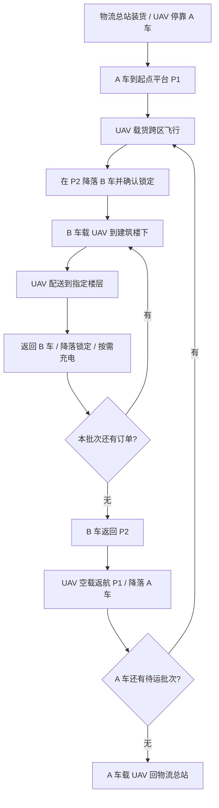

# 双车接力与楼层配送

## 1. 任务边界

本模式保留 PX4 SITL + ROS 2 Offboard，新增第二辆真实差速动力学 UGV。
起降节点是道路上的交接地点，UAV 实际从静止车辆的物理平台起降。
不使用持续设置模型坐标模拟飞行，不实现行驶中降落。



## 2. 保留与新增

- 原有 `cooperative_delivery.launch.py` 和独立 UAV、UGV 模式保留。
- 新入口：`ros2 launch cooperative_delivery relay_delivery.launch.py`。
- A 车保留原模型名 `ugvcar` 及原来的根命名空间导航，避免破坏单车功能。
- B 车模型名 `ugv_b`，控制器、传感器、Nav2 和关节名称均独立。
- A 车保持原 `ros2_control`。B 车采用 Gazebo 官方 `gazebo_ros_diff_drive` 与
  `gazebo_ros_joint_state_publisher` 驱动同一套轮关节，避免多实例控制插件的全局
  参数串线；驱动命令设置 0.5 秒仿真时间超时保护，轮速有加速度限制。
  参考：[Gazebo 官方差速驱动实现](https://github.com/ros-simulation/gazebo_ros_pkgs/blob/ros2/gazebo_plugins/src/gazebo_ros_diff_drive.cpp)。
- 两车共享 `/clock`、`map`、校园静态地图和道路掩膜，不修改 world 或地图。
- 双车模式独立生成 Nav2 参数副本，为两车加入 `PeerVehicleLayer`。它依据对方
  实时位姿标记半径 0.60 m 的车载平台包络，再由原膨胀层生成缓冲区；不是预测
  虚拟激光点。对方移动后旧位置参与重绘并被清除；1 秒仿真时间未收到位姿时
  保留最后包络并将代价地图标为非最新。该层仅用于已知车辆之间的协同避碰，
  不能替代雷达对其他未知障碍物的感知；仿真的 `world` 与 `map` 原点保持重合。
- TF：A 使用 `map -> odom -> base_footprint`，B 使用
  `map -> ugv_b/odom -> ugv_b/base_footprint`；UAV 保持原 TF。
- 原飞控、电量论文模型和楼层配送 Action 复用。

## 3. 启动和任务

先在原终端用 Ctrl+C 正常关闭旧 UAV/协同仿真。PX4 的 TCP 4560 或 Agent 的
UDP 8888 被占用时，新入口会拒绝启动，避免连接到旧飞控。

终端一：

```bash
cd ~/design_final/wqi_final/simulation_ws
bash ./build_workspace.sh
source ./setup_workspace.bash
ros2 launch cooperative_delivery relay_delivery.launch.py gui:=true rviz:=true
```

终端二：

```bash
cd ~/design_final/wqi_final/simulation_ws
source ./setup_workspace.bash
ros2 action send_goal /relay_delivery/execute_mission \
  cooperative_delivery_interfaces/action/ExecuteCooperativeDelivery \
  "{targets: ['teaching_building'], target_floors: [3], payload_masses_kg: [0.30], return_home: true}" --feedback
```

多订单示例：

```bash
ros2 action send_goal /relay_delivery/execute_mission \
  cooperative_delivery_interfaces/action/ExecuteCooperativeDelivery \
  "{targets: ['teaching_building', 'dormitory_2'], target_floors: [3, 4], payload_masses_kg: [0.30, 0.25], return_home: true}" --feedback
```

必须使用 `return_home: true`，否则拒绝任务。每件包裹不超过现有 UAV 最大载荷；
总载荷超过上限时按输入顺序分批接力，每批 B 车的配送顺序按道路图距离优化。
这不是全局最优的双车能量调度或最优装箱算法，不能在论文中作此表述。

终端三可观察：

```bash
ros2 topic echo /relay_delivery/mission_status
ros2 topic echo /relay_delivery/carrier_state
ros2 topic echo /uav/docked_carrier
ros2 topic echo /relay_delivery/readiness
```

默认同时打开 Gazebo、RViz。可分别设置 `gui:=false`、`rviz:=false`；
`visualize_sensor_rays:=false` 只关闭 Gazebo 扫描线显示，传感器仍工作。
VirtualBox 默认使用 `software_rendering:=true`；有可用显卡时可设为 `false`。
双车入口先等待 A 车轮控制器激活，再生成 B 车和 UAV，避免传感器初始化阻塞
控制器加载。Nav2 心跳超时为 30 秒，未禁用心跳。提交任务后 `readiness` 会列出
未准备好的接口，并检查两套 Nav2 确实处于激活状态；仅有 Action 名称还不够。

## 4. 平台与安全检查

配置 `simulation_ws/src/cooperative_delivery/config/relay_delivery.yaml`：

- P1：现有航路节点 `south_junction`，坐标 `(0, -18)`。
- P2：现有航路节点 `west_return_4`，坐标 `(6, 11)`。
- 跨区巡航高度 15 m；沿已有校园航路图飞行，不直接穿越建筑。
- 接收车必须停车；无人机正常降落、停止旋翼后才能捕获。
- 捕获距离上限 0.18 m；不允许在 A 车锁定状态下直接切换到 B 车。
- 捕获前检查接收车与 UAV 的实际位姿及线/角速度，并连续满足至少 1 秒仿真时间。
  速度预检采用按新传感器时间戳更新的 0.25 s 低通滤波，抑制 ODE 接触短脉冲；
  重复读取同一旧采样不会重复滤波，持续运动不能被当作静止。
  ROS 侧使用略严的 0.17 m 与速度预检，Gazebo 物理插件仍单独执行原始安全门限；
  仅对瞬时未稳定的服务拒绝有限重试，距离越界等错误不被忽略。
- `/uav/select_carrier` 选择捕获目标；`/uav/docked_carrier` 是实际锁定归属，
  二者不能混淆。

不要在接力任务期间从其他终端给两车或 UAV 发送独立导航/起降命令。
取消或失败会取消下游 Action 并停止地面车辆；跨区飞行失败可能保持空中悬停，
需查看 `/uav/px4/landing_fault` 和当前位姿后人工恢复，不能把失败标记为成功。

## 5. 五块电池与货物

默认 `enable_energy_constraints:=true`，电量模型：

| 电池 | 状态话题 |
|---|---|
| A 车驱动电池 | `/ugv_a/drive_battery_state` |
| A 车 UAV 充电电池 | `/ugv_a/charging_battery_state` |
| B 车驱动电池 | `/ugv_b/drive_battery_state` |
| B 车 UAV 充电电池 | `/ugv_b/charging_battery_state` |
| UAV 电池 | `/uav/battery_state` |

只有实际锁定的车辆向 UAV 供电并扣除自身充电电池能量。车载 UAV 质量和货物
质量分别计入对应车辆的驱动能耗；跨区载荷为本批次总质量，楼层配送载荷为当前
包裹质量，交接到车辆后不把同一包裹重复计入 UAV 载荷。

任务开始、两车移动前，新增 `relay_energy.py` 对按批次排序后的整个闭环做串行
五电池预检，包括：两车行驶、另一辆车等待、载荷交接和逐件卸货、跨平台去返、
楼层配送、补电等待时两车待机，以及有限车载充电电池。任一预测储备不足则在
准备阶段终止，不等到中途才发现充电源耗尽。

跨区飞行复用 `MissionEnergyPlanner.plan_transfer`，沿每条航段积分起飞加速、
匀速上升、减速悬停、水平加减速、下降及 PX4 起降等待；功率仍由原论文模型计算。
每次跨区起飞保留本次飞行、空载退回原车和 UAV 安全储备。正常任务不会因为
预留了退回能量而额外飞一次；它只是准入约束。楼层任务继续复用原能量服务。

补电储能差为 `ΔE` 时，预测等待时间与源电池支出分别为：

```text
t_charge = 3600 * ΔE / (η_uav * P_charge - P_docked_idle)
E_source = (ΔE + P_docked_idle * t_charge / 3600) / (η_uav * η_ugv)
           + P_charger_idle * t_charge / 3600
```

实际只允许已物理锁定的车辆供能。跨区充电等待前再次检查该车有限充电电池与
驱动电池待机余量；运行中保留各单段、落车、停车和电池保护，不用预测替代保护。
地面运输前按下一架次更新目标 SOC，避免沿用默认 100% 目标造成未计划补电。
行驶中仍可向当前目标 SOC 充电，但预检不提前依赖这部分机会充电收益。

```bash
ros2 topic echo /relay_delivery/energy_plan
```

准备阶段发布 JSON，含 `feasible`、拒绝原因、五电池预测剩余与净消耗、预计时长
和补电等待。之后每次跨区出发发布本次目标能量；需记录完整话题而非只截最后一条。
`consumed_wh` 是初末能量差：UAV 补电后可能为负，并不代表电机产生能量；不能
把车载充电支出与同一份 UAV 获得的能量重复计作全系统耗能。

预检不把地面行驶期间的机会充电计为可用收益，按配置速度、裕量和楼层服务时间
估算；未知的长时间堵塞、实际机会充电分配和恢复过程会改变结果，因此它不是
严格可达性证明或五电池全局最优调度。参数尚未实测标定。

### 5.1 低电量拒绝测试

关闭旧仿真后，终端一：

```bash
ros2 launch cooperative_delivery relay_delivery.launch.py \
  relay_config:="$(ros2 pkg prefix --share cooperative_delivery)/config/relay_smoke.yaml" \
  initial_ugv_charging_battery_percentage:=0.05 gui:=true rviz:=true
```

终端二发送第 6 节短程任务即可。预期 Action 为 `ABORTED`，消息包含
`Relay energy admission refused`，而不是完成配送；两车不得进入行驶阶段。
恢复正常任务需关闭本次仿真并重新启动，省略 5% 参数。不要为通过测试直接重置
运行中的电池或把失败结果改成成功。

2026-10-15 的真实负面验收保存在仓库外
`relay_regression/20261015/energy_rejection/`：原生 Action 状态 6、完成目标 0，
只出现 `IDLE -> RELAY_PREPARING -> FAILED`；两车采样最大平面位移分别约
`0.000018 m`、`0.000007 m`。`negative_assessment.json` 的五项独立断言通过。

## 6. 短距离闭环验收

短验收配置不改校园地图：A 从物流总站到 `(1.5,-41)`，B 在 `(0,-38)` 接机；
B 再回到物流总站门口完成一楼配送，返回自己的平台，最后将 UAV 返还 A。
P1 位于铺装道路侧部，避免把等待车辆停在试验通行线正中央。
跨平台飞行高度为 3 m，用于检查交接，不能替代正式 15 m 校园实验。

终端一用以下启动命令替代正式启动：

```bash
ros2 launch cooperative_delivery relay_delivery.launch.py \
  relay_config:="$(ros2 pkg prefix --share cooperative_delivery)/config/relay_smoke.yaml" \
  gui:=true rviz:=true
```

终端二：

```bash
ros2 action send_goal /relay_delivery/execute_mission \
  cooperative_delivery_interfaces/action/ExecuteCooperativeDelivery \
  "{targets: ['logistics_center'], target_floors: [1], payload_masses_kg: [0.05], return_home: true}" --feedback
```

验收必须看到实际锁定归属按 `ugvcar -> 空 -> ugv_b -> 空 -> ugv_b -> 空 -> ugvcar`
变化，并确认最终 A 车到总站、UAV 正常停靠，不能只看 Action 接受或模型生成。

## 7. 当前验证记录

2026-10-15，使用 PX4、两辆动力学 UGV、同一个原校园 world，开启 Gazebo 与
RViz，使用 `relay_smoke.yaml` 完成一次真实运行闭环（无动态障碍，启用能量约束）：

| 检查项 | 本次观测 |
|---|---|
| Action | `SUCCEEDED`，完成 1 个一楼配送目标 |
| 停靠归属 | `ugvcar -> 空 -> ugv_b -> 空 -> ugv_b -> 空 -> ugvcar` |
| 完整阶段 | A 到 P1、跨区交接、B 到楼下、楼层投递回收、B 回 P2、UAV 返 A、A 回总站 |
| A 最终总站位置误差 | 0.261 m |
| 三次锁定前最近采样的 UAV/接收车 XY 误差 | 约 0.016、0.024、0.008 m；采样时均已停转 |
| 两车采样最小中心距 | 1.446 m；相对两个 0.60 m 圆包络的净距约 0.246 m |
| 两车采样最大倾斜角 | 0.021 度 |
| 能量证据 | 五块电池状态均已记录；本次未触发低电量充电等待 |
| 时间 | 任务约 168.5 s 仿真时间；含启动约 1284 s 壁钟时间，任务时钟比约 0.14 |
| 构建 | 最终全部 15 个软件包编译成功 |
| 全工作空间测试 | colcon 汇总 545 项，0 错误、0 失败、28 跳过；汇总包含 CTest/pytest 包装项，不是 545 个唯一单元用例 |

原始证据在仓库外：
`/home/wqi/design_final_artifacts/relay_regression/20261015/attempt9/`。
其中 `events.jsonl` 是采样与事件，`result.json` 是 Action 结果，`assessment.json`
包含独立验收检查，`launch_console.log` 保留完整启动与运行日志。
独立辅助脚本保存在相邻的 `relay_regression/tools/`，不是提交源码的一部分。

本轮实际排查并修复：

1. B 车 `map -> ugv_b/odom` 无时间容差导致的 TF 向未来外推。
2. 传感器并发加载阻塞 A 车控制器，改为确认轮控制器激活后再生成 B/UAV。
3. 虚拟机启动时 4 秒 Nav2 心跳建链超时；双车入口改为 30 秒，保留保护。
4. 对方车辆占用层受到 B 车统一重映射影响，把自身位姿标为障碍；分开导航与
   预测器重映射，并通过真实 ROS 话题解析测试与运行时代价地图服务检查确认。
5. 晚启动管理器收不到仅在变化时发布的已降落状态，改用 transient-local 订阅。

`attempt6` 是控制器未激活导致的失败；`attempt7`、`attempt8` 为定位上述问题
而主动中止的负面证据。更早的 `20261014/attempt5` 因运行中断且日志尾部有损坏，
不能算完整闭环通过。原始记录未删除，也没有用成功记录覆盖失败记录。

**验收边界：**这只是一次短距离、一楼、单包裹、静态场景验收，不是正式校园
15 m 长航路、多楼栋、多楼层、多批次或四档动态障碍的重复实验结果。间距和
姿态来自每 2 秒壁钟的位姿采样，不等同于接触传感器提供的连续无碰撞证明。
锁定后位置会由固定关节捕获对齐，不能用锁定后的微小误差宣称自主着陆精度。
后续还需低电量拒绝/补电专项、多包裹容量分批、取消/故障恢复和正式重复矩阵；
原评估工具的单车汇总不能直接当作双车五电池全系统能耗。
本机 RViz 仍记录索引地图 GLSL 着色器报错；已核对窗口及 ROS 数据，但没有完成
自动像素级渲染检查。2026-10-15 用户已目视确认校园地图和三个模型显示正常；
该结论属于人工确认，不是自动截图检测结果。

后续增量验证：整程五电池预检和跨平台分阶段功率模型已加入；全工作空间测试
汇总为 577 项、0 错误、0 失败、28 跳过。原有 XML 校验曾因 HTTP schema 下载
失败，现使用附带来源说明的 ROS 官方本地 schema；没有删除或跳过校验。
合成地图测试已确认 RViz 收到地图并尝试渲染，但 Xwayland 窗口截图全黑，GNOME
截图接口拒绝访问；没有绕过桌面权限，也未据此判定实际地图必然黑屏。
自动验证限制记录在 `rviz_map_probe*` 目录；随后用户已给出上述人工确认。

正式 15 m 航路、教学楼三楼、三楼栋订单和十包裹四批次已完成离线能量预演，
结果见仓库外 `relay_regression/20261015/formal_route_energy_forecasts_v2.json`。
默认 80% 初始电量下三个计划均通过模型预检；这不是 Gazebo 运行成功或实测
耗能数据。十包裹计划的预测补电时间较长，不能把短程验收时长外推为批量性能。
`short_floor3/` 是发现默认充电目标偏差后主动中断的负面记录，未计为闭环通过。
`short_floor3_v2/` 在三楼完成投递并降落后，被物理插件的稳定性保护拒绝锁定，
Action 为失败且闭环确认目标数为 0。原日志仅给出合并拒绝原因，不能从中断定
具体是哪一项速度越限。现增加 UAV/车身线角速度采样与插件四项速度诊断，并在
停转后等待连续稳定，而非把 PX4 的已降落状态直接等同于安全锁定。
充电等待同时设置仿真时间上限、宽裕壁钟保护，并保留时钟停滞/回退和取消检测。
`short_floor3_v3/` 在 P2 已降落但未锁定：接触短时角速度脉冲不断打断逐样本
稳定判定，等待达到上限后安全失败。后续只对 ROS 侧预检做短窗滤波，物理插件
依旧检查未滤波的实际速度；没有增大捕获范围、放宽速度限值或强制消除速度。

### 7.1 三楼闭环最终验证

`short_floor3_v4/` 在上次聊天中断后由独立监督器继续执行并正常完成。
采用原校园 world、PX4、Gazebo 与 RViz、短程 3 m 跨平台配置、物流中心三楼
投递点（8 m）、0.30 kg 载荷，无动态障碍，启用五电池约束。

| 项目 | 记录 |
|---|---|
| Action | `SUCCEEDED`，闭环确认目标数 1 |
| 独立验收 | 11 项均通过，实际停靠归属及所有阶段完整 |
| A 回总站误差 | 0.250 m |
| 两车采样最小中心距 | 1.454 m |
| 两车采样最大倾斜角 | 0.030 度 |
| 任务仿真时长 | 从提交目标到结果约 193.9 s |
| 壁钟时长 | 含启动约 1256 s；任务段约 1178 s |
| 五电池模型净耗电 | 约 13.616 Wh；不是实测电池电流 |

五电池净变化分别为 A 驱动 `2.445 Wh`、A 充电 `0.014 Wh`、B 驱动
`2.644 Wh`、B 充电 `0.025 Wh`、UAV `8.488 Wh`。统计从准入后首个完整
SOC 采样开始，采样异步，不是严格同步的仪器测量。

本次首次捕获、三楼回收和返还 A 的过程中，插件分别有 2、2、1 次瞬时速度
拒绝，均在重新等待后通过原始限值，而非忽略保护。本次日志明确记录到接收车
角速度越限；不能把这个诊断反推为早期所有失败都由同一原因导致。

原始 `result.json`、`events.jsonl`、`assessment.json`、`five_battery_metrics.json`
和三个 PX4 `.ulg` 日志均已保存在该目录；`.ulg` 有来源、大小和 SHA256 清单。
固定关节锁定后的极小对齐误差不代表自主着陆精度。

准入预测总净能量约 `28.881 Wh`、时长 `473 s`，高于上述运行积分结果；
服务时间预留、PX4 起降等待和预测裕量尚需多个工况标定，不能声称模型精度已达标。
本次也未触发专门的低 SOC 补电等待，不代替充电曲线专项。

### 7.2 下一轮独立测试工具

工具放在仓库外 `~/design_final_artifacts/relay_regression/tools/`，不属于导师
提交源码。源码仓库本身仍可用第 3、6 节 ROS 命令运行，不依赖这些便利工具。

```bash
cd ~/design_final/wqi_final/simulation_ws
source ./setup_workspace.bash
TOOLS=~/design_final_artifacts/relay_regression/tools
# 仅校验配置，不启动仿真。
/usr/bin/python3 "$TOOLS/relay_regression.py" --check-only \
  --scenario "$TOOLS/scenarios/formal_teaching_floor3.json"
# 真正启动正式 15 m 航线；默认同时打开 Gazebo、RViz，勿与其他仿真并行。
/usr/bin/python3 "$TOOLS/relay_regression.py" \
  ~/design_final_artifacts/relay_regression/results/formal_teaching_01 \
  --scenario "$TOOLS/scenarios/formal_teaching_floor3.json"
```

另外提供 `formal_three_buildings.json` 和 `smoke_two_batches.json`，分别用于
三楼栋和容量分批验收。输出目录必须是新的，工具不会覆盖已有原始实验。
JSON 中 `obstacle_density` 可设 `none/low/medium/high`，`random_seed` 固定种子；
先完成静态与分批验证，再运行动态档位。正式长航路可能需要数小时壁钟时间，
配置含有限超时，不用短程时长推算完成时间。

结束后可执行：

```bash
OUT=~/design_final_artifacts/relay_regression/results/formal_teaching_01
/usr/bin/python3 "$TOOLS/relay_assess.py" "$OUT"
/usr/bin/python3 "$TOOLS/relay_energy_metrics.py" "$OUT"
/usr/bin/python3 "$TOOLS/preserve_px4_logs.py" "$OUT"
```

验收工具现在按订单数与实际载荷容量推导停靠序列，不再固定只能检查一单。
工具层 23 项测试通过，并已对本次三楼记录做只读重验；这些配置的校验与
单元测试不代表正式长航路、多订单或四档动态场景已经实际通过。

## 8. 2026-10-16 退出异常修复

用户重跑的 `results/smoke_20261015_234952/` 成功完成短程三楼 0.30 kg 配送，
独立验收 11 项通过。任务 192.6 仿真秒、含启动 1212.6 壁钟秒，五电池模型
净耗电约 13.608 Wh。但是任务完成后的 SIGINT 退出存在真实异常：信息节点
退出码 -11，控制器超过默认 5 s 后被 SIGTERM 终止。不能把成功的配送结果
等同于正常的进程退出。

检查系统崩溃转储后，段错误栈顶为 Fast DDS 2.6.11 的
`EDP::unpairWriterProxy`，主线程同时处于端点销毁路径。没有证据说明这是
路径算法错误，也没有直接升级、覆盖系统 DDS 库。

本次修复只对双车入口启用：

- `ugvcar_navigation2/managed_filter_info_server` 继续实例化官方
  `nav2_map_server::CostmapFilterInfoServer`，不改消息、可靠性、持久性或掩膜。
  信号处理器只设置停止标记；执行线程停止后，在 ROS Context 仍有效时清理
  生命周期、bond 和节点，最后关闭 Context，避免异步信号线程与节点析构交错。
- 退出升级等待从 5 s 改为 20 s，随后保留 10 s 强制清理上限，不吞掉退出错误。
- 两车静态控制器默认 10 Hz，行为树周期 100 ms，RViz 显示 10 Hz。
  `controller_frequency` 只接受 5--20 Hz；动态控制器仍为既有的 10 Hz。
  不更改速度、规划插件、代价地图或原始捕获门限。单车入口默认不变。

生命周期行为复用自 [Nav2 官方实现](https://github.com/ros-navigation/navigation2/blob/humble/nav2_util/src/lifecycle_node.cpp)，
不是替换官方代价地图功能或重新实现导航。

### 专项验证结果

`relay_regression/20261016/shutdown_regression_01/` 同时打开 Gazebo、RViz，
加载两辆物理车及 PX4 UAV。实时参数读取确认两车 10 Hz、行为树 100 ms。
A 从总站向前行驶约 2.5 m，B 从 P2 向前行驶约 1.5 m，两次 Nav2 Action
均为状态 4；收到结果时异步物理采样误差分别约 0.338 m、0.264 m。
随后退出用时 6.175 s，两个信息节点正常退出，没有 -11、退出超时或升级信号。
结果在 `probe_result.json`，测试脚本与原始日志均在仓库外。

全部 15 包编译通过；全工作空间测试汇总 592 项、0 错误、0 失败、29 跳过，
包含 CTest 包装项和静态分析条目，不是 592 个唯一单元用例。
新增原生 ROS 测试确认晚订阅仍接收正确过滤器元数据，SIGINT/SIGTERM 均返回 0。
测试最初发现的独立 Context/Executor 配对和格式问题已修正，最终重跑零失败。

本次不是完整楼层配送重跑，也不是 Fast DDS 内部缺陷已被普遍修复的证明。
控制/行为树超时和首次 RViz GLSL 着色器报错仍能在该 VM 下出现；降低频率不
保证主机始终按时调度，也不保证任何速度下均无 S 形。此前用户确认过地图模型
正常，但本次未获得新的像素级验证，不能把一次 GLSL 报错自动等同于地图不可用。
正式配送及重复退出仍需继续验收。
